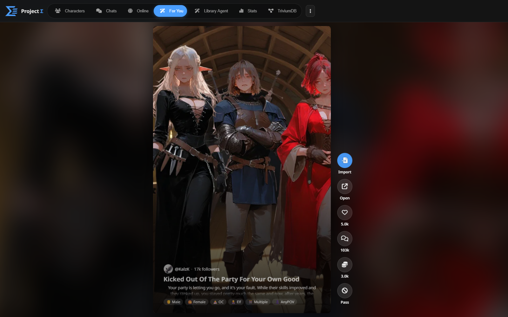
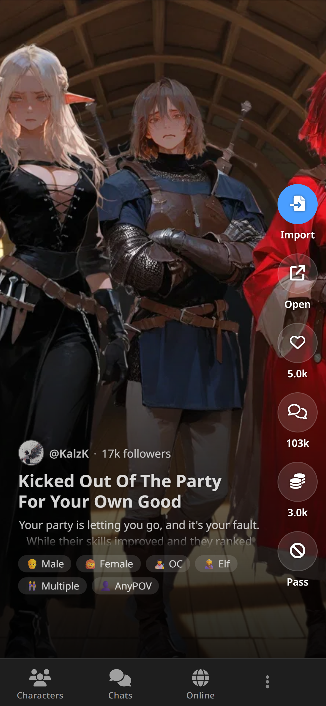
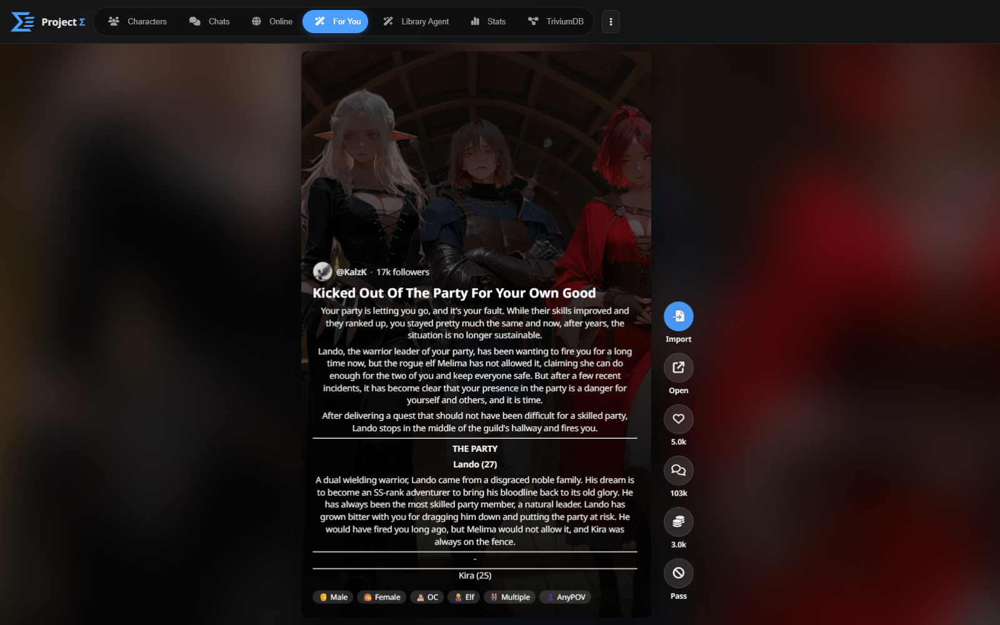
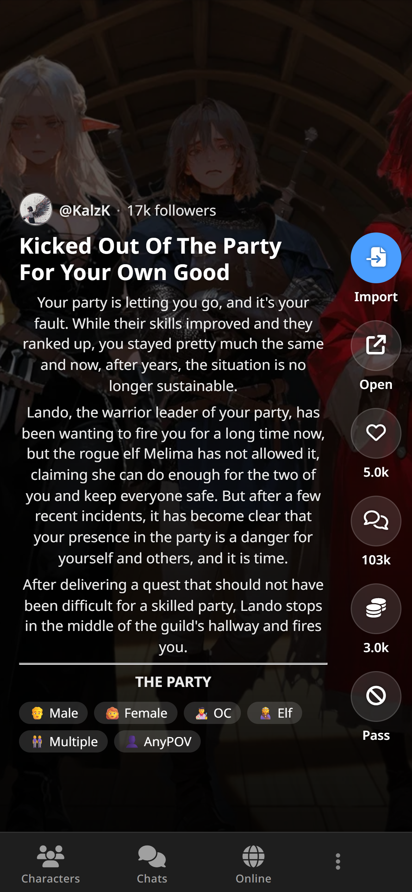

# Janitor For You (Project Σ extension)

  
  &nbsp;&nbsp;
  

> **Status: 0.1.0 work-in-progress.** Swipe feed and optional native Grid layout; import opens Sigma's own JanitorAI preview.

JanitorAI's personalized **For you** feed (`janitorai.com/?segment=discover`, `/foru/<id>`) inside Sigma: one recommended
character per full-height swipe slide, with ↑/↓ or j/k navigation, automatically loaded recommendations,
expandable creator descriptions, creator profile pictures, and Import / Open / Pass actions. Choose **Grid** in settings for Sigma's native browse cards; clicking a card opens the same preview. NSFW stays opt-in in both layouts.

## Screenshots
| | Desktop | Mobile |
|---|---|---|
| **Feed** |  |  |
| **Description open** |  |  |

Captured with Show NSFW off. Card art and descriptions belong to their JanitorAI creators. A higher-quality clip of the GIF is in [`docs/images/mobile-swipe.mp4`](docs/images/mobile-swipe.mp4).

## Controls
The rail beside each card, top to bottom:

| Button | What it does |
|---|---|
| **Import** | Opens the card in Sigma's own JanitorAI preview (Online), where you can import it |
| **Open** | Opens the character's page on JanitorAI in a new tab |
| ♡ **Favorites** | How many people favorited the card on JanitorAI (display only; favorite sync isn't built yet) |
| 💬 **Chats** | How many chats people have started with the card |
| 🪙 **Tokens** | The card's token count; tapping it opens or closes the description |
| **Pass** | Skips the card ("Not interested"); with **Teach the feed** on, JanitorAI is told too |

Tap the description to expand it. Scroll or swipe, ↑/↓ or j/k to move between cards.

## Requirements
- Project Σ with extension API **2.7** (Hosted Browser consumer door).
- Signed in to JanitorAI in Sigma (**Settings > Online > JanitorAI**). The feed is per-account; logged out there is none.
- Hosted Browser set up (**Settings > Online > Hosted Browser**); janitorai.com is behind a firewall that blocks plain requests.

## What it reads, writes and sends
- **Reads:** your JanitorAI session token from Sigma's own JanitorAI login (setting `janitoraiToken`), only to put it in
  the `Authorization` header of the requests below. It never stores or logs it.
- **Writes:** its four settings (`sendSignals`, `showNsfw`, `minTokens`, `layout`). Browsing itself writes nothing to your library.
  Import opens Sigma's own JanitorAI preview: its definition fetch, duplicate check and import dialog run there;
  only confirming that native import writes the character into your library. No direct `character.import` call.
- **Sends** feed requests through the Hosted Browser to `https://janitorai.com/hampter/recsys/`:
  - `GET home` (the recommended ids), `GET home/cards` (their cards), `GET home/personalization` (a new account's readiness).
  - Only with **Teach the feed** on (off by default): `POST events` (card shown, time spent, skipped, session start/end)
    and `POST home/feedback` (Not interested), the same signals the website sends, so your feed on the site changes too.

Portraits and blurred backgrounds load from JanitorAI's image host (`https://ella.janitorai.com/`); the current
and next three swipe portraits are preloaded. Preview/import additionally uses Sigma's JanitorAI provider
network path. Open (or Import with the provider disabled/missing) opens the character's JanitorAI URL in a new tab.
The active Sigma persona name/pronouns are read locally to answer description macros; they are not sent as feed signals.

## Settings
| Key | Default | Meaning |
|---|---|---|
| `sendSignals` | `false` | Send view/skip/not-interested signals like the site does |
| `showNsfw` | `false` | Show cards JanitorAI marks NSFW (only an explicit `true` opts in) |
| `minTokens` | `100` | Hide cards under this many tokens (filters out "announcement" bots) |
| `layout` | `swipe` | Swipe feed (default) or native Grid; changing it rebuilds the view |

## How a new account's feed starts (observed in the site's client)
1. A new profile has `tag_preferences.status: "pending"`; the site redirects to `/onboarding?step=interests`, an
   "interests wall" where you pick tags (or skip). Saved with `PATCH /hampter/profiles/mine/tag-preferences`
   `{ tag_ids, custom_tags, status }`. Older accounts read `"not_required"`.
2. The first `GET recsys/home` may answer `personalization: "pending"`; the client polls `home/personalization` up to
   4 × 1 s, then asks again. This extension does the same.
3. After that it learns from the events above, plus chats started from the feed (`recsys_context` on chat create).

## Next steps
- **STOPGAP preview readiness:** `client/core/preview.js` isolates private `browseView._initialized` and
  `window.ProviderRegistry` activation/deactivation calls, pending **Online Browse - Extension Content Modes**.
  Cold activation rebuilds Online's pane, can reset its prior search/scroll, and triggers an initial browse request.
  Missing/failing/stalled internals degrade to an informational toast, never a half-wired preview.
- Creator/tag buttons currently show an honest feature-needed toast; no documented pre-filtered Online navigation door exists.
- Decide placement: the skill rule is "online browsing lives in the Online tab"; a For you *kind* on the JanitorAI provider
  would need a core door (kinds are hard-coded), so this ships as a shell view for now.
- `session.js` is a STOPGAP (reads the core JanitorAI token, never refreshes it). Candidate feature request: a provider-session door.

## Tests
`node --test test/` from this folder (uses `D:/ProjectSigma-main` or `SIGMA_DIR` for the lint check).
`test/index.js` makes the directory form work on Node versions that resolve it as a module.
The equivalent direct suite command is `node --test test/*.test.mjs`.

## License
GPL-3.0 © DJLegends. See [`LICENSE`](LICENSE).
